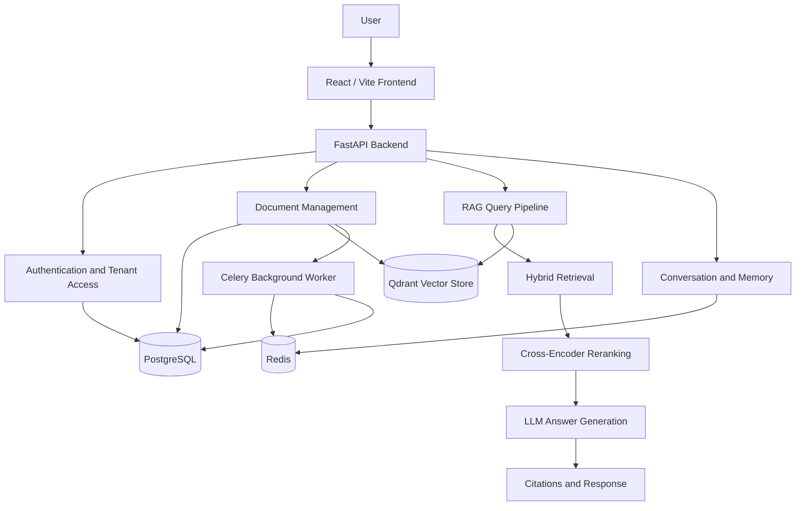

# Advanced RAG Platform

A production-oriented, multi-tenant Retrieval-Augmented Generation (RAG) platform built with FastAPI, LangChain, LangGraph, PostgreSQL, Qdrant, Redis, Celery, and React.

The platform provides authenticated document workflows, retrieval-augmented question answering, conversation management, and tenant-aware application services.

[](https://github.com/Mrshayan07/Advanced-RAG-Platform-End-to-End-Industry-Level-Project/actions/workflows/ci.yml)

## Features

- **RAG API:** Question-answering endpoints backed by the application's retrieval pipeline.
- **Document workflows:** Document upload and document management endpoints.
- **Hybrid retrieval:** Dense retrieval and BM25-based retrieval components.
- **Reranking:** Cross-encoder reranking support.
- **Conversation management:** Conversation and message persistence.
- **Authentication and authorization:** Authentication endpoints and role-aware user management.
- **Multi-tenancy:** Tenant-aware application and data-access components.
- **Long-term memory:** User-memory and conversation-memory components.
- **Evaluation:** Evaluation datasets, pipeline evaluation utilities, and DeepEval integration.
- **Background processing:** Celery worker and Redis-backed infrastructure.
- **Containerization:** Docker image and Docker Compose service configuration.

Feature availability depends on the configured services, environment variables, and application code.

## Technology Stack

| Area | Technologies |
|---|---|
| Backend API | Python 3.12, FastAPI, Uvicorn |
| RAG orchestration | LangChain, LangGraph |
| Database | PostgreSQL, SQLAlchemy, Alembic |
| Vector database | Qdrant |
| Cache and task queue | Redis, Celery |
| Frontend | React, Vite, JavaScript |
| Model integrations | Groq, Gemini, Hugging Face model components |
| Evaluation | DeepEval and project evaluation utilities |
| Quality checks | pytest, pytest-asyncio, Ruff, oxlint |
| Deployment packaging | Docker, Docker Compose |

## Architecture



The API coordinates authentication, document workflows, retrieval, response generation, and conversation features. PostgreSQL stores relational data, Qdrant supports vector search, and Redis/Celery support background processing.

## Project Structure

```text
advanced-rag/
├── app/                    # FastAPI backend and RAG components
├── frontend/               # React + Vite frontend
├── tests/                  # Automated backend tests
├── eval/                   # Evaluation datasets and results
├── scripts/                # Maintenance, integration, and evaluation scripts
├── migrations/
│   └── versions/            # Alembic migration history
├── docker/                 # Supporting Docker configuration
├── infra/                  # Infrastructure configuration, when implemented
├── .github/
│   └── workflows/           # GitHub Actions workflows
├── storage/                # Local documents and runtime artifacts
├── Dockerfile
├── docker-compose.yml
├── alembic.ini
├── pyproject.toml
├── requirements.txt
├── requirements-dev.txt
├── pytest.ini
├── .env.example
└── README.md
```

Local environment files, virtual environments, generated data, and other private artifacts should not be committed.

## Prerequisites

For the containerized setup:

- Docker Desktop with Docker Compose support
- Sufficient disk space and memory for the backend dependencies and reranker model

For local development:

- Python 3.12
- Node.js and npm
- PostgreSQL, Qdrant, and Redis, either locally or through Docker Compose

The Docker image downloads the configured cross-encoder reranker during image build. Initial builds can therefore take significant time and disk space.

## Environment Configuration

Create your local environment file from the example:

```powershell
Copy-Item .env.example .env
```

Edit `.env` locally and configure the required settings. Do not commit this file or share its secret values.

Important configuration variables include:

| Variable | Purpose |
|---|---|
| `DATABASE_URL` | Application database connection |
| `POSTGRES_PASSWORD` | PostgreSQL container password |
| `QDRANT_URL` | Qdrant endpoint |
| `QDRANT_API_KEY` | Optional Qdrant authentication |
| `REDIS_URL` | Redis connection |
| `JWT_SECRET_KEY` | JWT signing secret |
| `GROQ_API_KEY` | Groq model integration |
| `GEMINI_API_KEY` | Gemini model integration |
| `LANGSMITH_TRACING` | LangSmith tracing configuration |
| `LANGSMITH_API_KEY` | LangSmith API key when tracing is enabled |
| `CORS_ORIGINS` | Comma-separated allowed frontend origins |
| `EMBEDDING_MODEL` | Embedding model identifier |

Use strong, unique secrets and environment-appropriate database URLs. Keep `.env.example` limited to placeholders and non-sensitive defaults.

## Run with Docker Compose

From the project root:

```powershell
docker compose up -d --build
```

Check service status:

```powershell
docker compose ps
```

Inspect application logs without publishing environment configuration:

```powershell
docker compose logs --tail 100 api
docker compose logs --tail 100 worker
```

The API is configured for port `8000` in the Docker image. If the Compose configuration maps that port to the host, open:

- API root: `http://localhost:8000/`
- Interactive API documentation: `http://localhost:8000/docs`

The exact host ports and health status depend on the active Compose configuration.

### Optional Redis development override

The additional Redis port mapping is defined in `docker/redis-ports.override.yml`. To explicitly apply that override:

```powershell
docker compose -f docker-compose.yml -f docker/redis-ports.override.yml up -d
```

Use the override only when its local Redis port mapping is needed.

## Run the Frontend

Open a separate terminal:

```powershell
Set-Location .\frontend
npm ci
npm run dev
```

Vite normally serves the development frontend at `http://localhost:5173`.

The backend CORS configuration must allow the frontend's origin. Configure `CORS_ORIGINS` for the URLs used by your environment.

Available frontend scripts:

```powershell
npm run lint
npm run build
npm run preview
```

## Run the Backend Locally

Create and activate a Python virtual environment from the project root:

```powershell
python -m venv .venv
.\.venv\Scripts\Activate.ps1
python -m pip install --upgrade pip
pip install -r requirements-dev.txt
```

Configure `.env` with valid service URLs and required settings before starting the backend.

Run database migrations against the intended application database:

```powershell
alembic upgrade head
```

Start the API:

```powershell
uvicorn app.main:app --reload --host 127.0.0.1 --port 8000
```

Do not run migrations against a database unless you have confirmed its identity and intended purpose.

## Database Migrations

Migration files are stored in `migrations/versions/`.

Inspect the current migration head:

```powershell
alembic heads
```

View migration history:

```powershell
alembic history --verbose
```

Apply available migrations:

```powershell
alembic upgrade head
```

Back up important databases before applying schema changes to shared or production environments.

## Testing and Code Quality

The pytest configuration is in `pytest.ini`; the test suite is under `tests/`.

Run the backend tests only after configuring a dedicated test database named `ragdb_test`:

```powershell
pytest
```

The test fixtures reset test data before each test. Never point the test configuration at a production or application database.

Run Ruff:

```powershell
ruff check .
```

Run frontend lint and build checks:

```powershell
Set-Location .\frontend
npm ci
npm run lint
npm run build
```

Some tests or integrations may require external services. Configure those dependencies explicitly before running the relevant tests.

## Evaluation

The repository contains evaluation utilities under `app/evaluation/`, scripts under `scripts/evaluation/`, and evaluation datasets under `eval/`.

Evaluation runs may require model-provider credentials or access to external services. Keep credentials in environment variables and do not commit evaluation output that contains private documents or sensitive data.

## Security Guidelines

- Never commit `.env`, API keys, JWT secrets, database passwords, or private credentials.
- Keep `.env.example` free of real secrets.
- Use a dedicated test database named `ragdb_test`.
- Do not expose PostgreSQL, Redis, or Qdrant ports publicly unless explicitly required and properly secured.
- Configure CORS origins for the intended environment rather than allowing arbitrary origins.
- Review generated logs, evaluation results, uploaded documents, and secret-scan reports before sharing them.
- Rotate credentials if they have been exposed in logs, screenshots, chat messages, or repository history.
- Review Docker Compose environment handling before using the configuration in a production deployment.

## Current Development Status

- Backend API, frontend, database migrations, and automated tests are included.
- Docker Compose configuration supports the local multi-service setup.
- GitHub Actions CI is configured for backend tests, frontend checks, and secret scanning.
- The workflow includes publishing the container image to GitHub Container Registry (GHCR).
- Local health checks and the CI workflow have been reported as passing during project verification.
- **Cloud deployment:** AWS/production hosting has not been completed; do not treat this repository as a live hosted service.
- Before public distribution, review the deployment configuration, environment secrets, and licensing requirements.

## License

This project is licensed under the MIT License. See the [LICENSE](LICENSE) file for the full license text.
